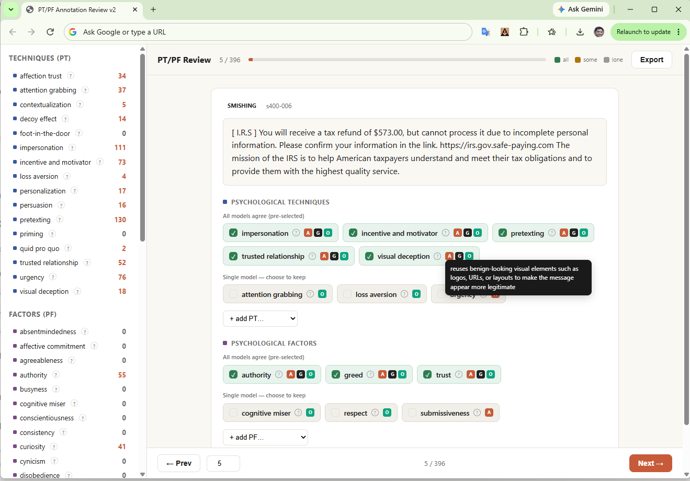

# SMSPsych: Automated Multi-Label Mapping of Psychological Techniques and Factors in SMS Texts

Code, data, predictions, and results for the SMSPsych paper (under review).

SMSPsych maps an SMS message to the psychological techniques (PTs) it uses and the psychological factors (PFs) it targets, using a taxonomy of 16 PTs and 46 PFs.

## Repository structure

| Folder | Contents |
|---|---|
| `taxonomy/` | The 16 PTs and 46 PFs with definitions. |
| `annotation/` | Scripts that collect candidate labels from three LLMs and build the reference labels, plus the review interface. |
| `data/` | The annotated corpus (2,110 messages) and the scripts that selected the messages. |
| `models/` | Scripts for the 11 evaluated configurations: 5 prompted, 5 LoRA-adapted, 1 fine-tuned encoder. |
| `predictions/` | The model outputs used for the paper tables. |
| `evaluation/` | Scripts that compute the scores and tables. See `evaluation/README.md`. |
| `results/` | Saved outputs of the evaluation scripts. See `results/README.md`. |

## taxonomy/

- `pts.txt`: the 16 psychological techniques, one per line as `label: definition`.
- `pfs.txt`: the 46 psychological factors, in the same format.
- `definitions.json`: the same definitions as JSON, used by the review interface.

## annotation/

Scripts, in the order they run:

| Step | Script | What it does |
|---|---|---|
| 1 | `annotate_openai.py`, `annotate_anthropic.py`, `annotate_grok.py` | Ask GPT-5.5, Claude Opus 4.8, and Grok 4.3 for candidate PT and PF labels. All three use the same prompt and taxonomy from `common.py`. |
| 2 | `review_interface.html` | Browser tool for human review. Load the candidate files and `taxonomy/definitions.json`. The reviewer can accept or reject each proposed label and add missing labels. |



*The review interface: the message, the labels proposed by each model, and the reviewer's selection.*

### Candidate label files

These are the output of step 1.

| Folder | Messages | Candidate files | Answer key |
|---|---|---|---|
| `candidates/` | the 396 test messages | `openai_*.jsonl`, `anthropic_*.jsonl`, `grok_*.jsonl` | `candidates/labels/sample_400_answer_key.jsonl` |
| `candidates_batch2/` | the 1,714 development messages | `openai_*.jsonl`, `anthropic_*.jsonl`, `grok_*.jsonl` | `candidates_batch2/labels/batch2_answer_key.jsonl` |

- Each line of a candidate file has the fields `id`, `message`, `pts`, `pfs`, and `raw` (the model's raw output).
- Each line of an answer key has the fields `id` and `source` (`smishing` or `benign`).

### How to use the review interface

Open `annotation/review_interface.html` in a web browser. It runs locally and needs no installation. Then load three things:

1. **Candidate files (required).** Click "Choose candidate files" and select the three model files from one folder, for example the three files in `annotation/candidates_batch2/`. Select all three together.
2. **Answer key (optional).** Select the single file in the `labels/` folder of the same candidate folder. With it, each message shows a tag that says whether it is smishing or benign. Without it, the tag shows "unknown".
3. **Definitions (optional).** Select `taxonomy/definitions.json`. With it, every label shows its definition when you hover over the "?" next to it, and all 16 PTs and 46 PFs appear in the "add" lists. Without it, the tool uses a shorter built-in list that covers only some of the PFs.

Click "Start review". For each message:

- Labels proposed by all models are selected already. Click a label to keep or remove it.
- Use the "+ add PT" and "+ add PF" lists to add a label that no model proposed.
- Move between messages with the Prev and Next buttons or the arrow keys.

Progress is saved in the browser, so you can close the page and continue later with "Resume saved progress". Click "Export" to download the reviewed labels as a JSONL file.

API keys are read from environment variables: `OPENAI_API_KEY`, `ANTHROPIC_API_KEY`, `XAI_API_KEY`.

## data/

| File | Contents |
|---|---|
| `gold_final.jsonl` | Test set: 396 messages (198 smishing, 198 benign). |
| `gold_final_batch2.jsonl` | Development pool: 1,714 messages (857 smishing, 857 benign). |

Each line is one message with the fields `id`, `message`, `source` (`smishing` or `benign`), `pts`, and `pfs`.

Scripts that selected the messages, in the order they ran:

1. `sample_400.py`: stratified random sample of 400 messages (200 smishing, 200 benign).
2. `check_language.py`: flags non-English messages.
3. `remove_ids.py`: removes flagged messages (400 → 396).
4. `build_batch2.py`: builds the second batch of 1,714 messages from the remaining smishing messages and an equal number of benign messages.

The four messages removed in step 3 are `s400-002`, `s400-026`, `s400-110`, and `s400-324`. Their IDs are listed inside `remove_ids.py`.

### data/raw/

The two source files that the selection scripts read:

| File | Source | Column used |
|---|---|---|
| `analysisdataset-2.csv` | SmishTank | `MainText` (encoding: latin-1) |
| `smish-mandely.csv` | SMS phishing dataset of Mishra and Soni | `TEXT`, rows where `LABEL` is `ham` (encoding: utf-8-sig) |

All 1,055 smishing messages come from SmishTank. The 1,055 benign messages are sampled from the messages labeled "ham" in the Mishra and Soni dataset.

These two files belong to their original authors and are included only so the selection scripts can be run. Please cite the original datasets and follow their terms of use. The scripts read the files from the folder they run in, so copy them there first.

## models/

| Configuration | Script | Job file |
|---|---|---|
| Prompted (5 models, zero-shot) | `run_prompted.py` | `regen_prompted.sbatch` |
| LoRA Gemma-4-E4B | `train_lora_gemma.py` | `regen_lora_gemma.sbatch` |
| LoRA Qwen3.5-4B | `train_lora_qwen.py` | (run directly) |
| LoRA Qwen3.5-9B | `train_lora_qwen9b.py` | `lora_qwen9b.sbatch` |
| LoRA Llama-3.1-8B | `train_lora_llama.py` | `lora_llama.sbatch` |
| LoRA Phi-3-mini | `train_lora_phi.py` | `lora_phi.sbatch` |
| Encoder, fixed split | `train_bert_all.py` | (run directly) |
| Encoder, 5-fold cross-validation | `train_bert_kfold_all.py` | `bert_all_2110.sbatch` |

- All fine-tuned models train on `gold_final_batch2.jsonl` and are tested on `gold_final.jsonl`. The 5-fold run pools both files.
- LoRA models: rank 4, 10% of the training data held out for validation, seed 42.
- Encoder: `bert-base-uncased`, 15% validation, decision threshold 0.8, seed 42.
- The job files are SLURM scripts. Replace `YOUR_ACCOUNT` with your own account.
- The scripts read the data and taxonomy files from the folder they run in. Copy the files from `data/` and `taxonomy/` there first.

## predictions/

| Folder | Files |
|---|---|
| `prompted/` | One file per prompted model: `<model>_zero_shot_<time>.jsonl`. These files also keep the raw model output in the `raw` field. |
| `lora/` | `lora_gemma_pred.jsonl`, `lora_qwen_pred.jsonl`, `lora_qwen9b_pred.jsonl`, `lora_llama_pred.jsonl`, `lora_phi_pred.jsonl` |
| `encoder/` | `bert_batch2_all_pred_thr08.jsonl` (fixed split, 396 messages) and `bert_expanded_all_pred_thr08.jsonl` (5-fold cross-validation, 2,110 messages) |

## Reproducing the tables

See `evaluation/README.md` for the exact commands. The saved outputs are in `results/`.

## Setup

```bash
pip install -r requirements.txt
```

Tested with Python 3.11.15. See the note in `requirements.txt` for the CUDA build of PyTorch.

## File names changed for this repository

A few files were renamed when the repository was prepared. Their content is the same.

| Name in this repository | Name when the experiments ran |
|---|---|
| `taxonomy/pts.txt` | `pts-receiver.txt` |
| `taxonomy/pfs.txt` | `pfs-sender.txt` |
| `models/run_prompted.py` | `run_inference_poster.py` |

The prompted run read its input from `eval_396.jsonl`, which has the same IDs and messages as `data/gold_final.jsonl`.